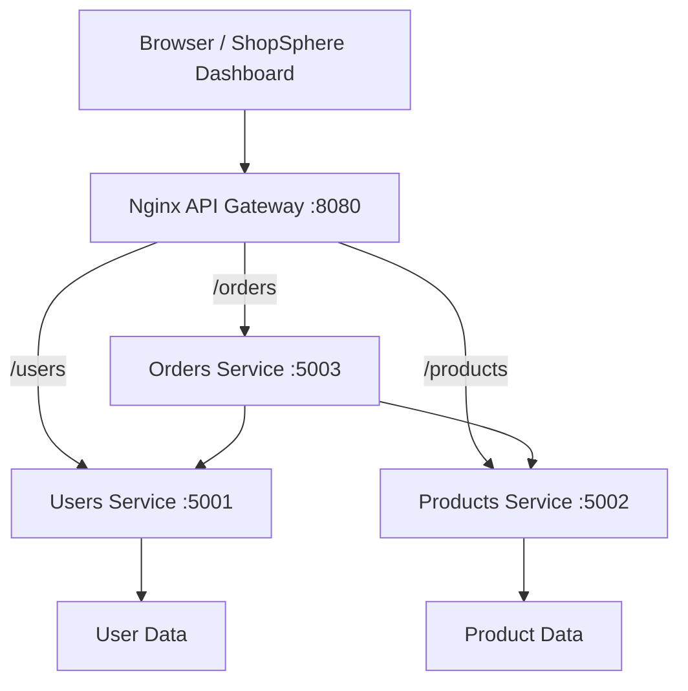

# ShopSphere Docker

A containerized e-commerce microservices demo built with Docker, Docker Compose, Python, and Nginx.

<p align="center">
  <b>Microservices • API Gateway • Load Balancing • Interactive Dashboard</b>
</p>

## Overview


ShopSphere demonstrates how a small e-commerce application can be divided into independently containerized services. An Nginx gateway routes incoming requests to the backend APIs, while Docker Compose manages the service lifecycle and dependencies.

The project includes a browser-based dashboard for interacting with the Users, Products, and Orders services.

## Architecture



## Features

- **Dockerized microservices:** Users, Products, and Orders run as separate containers.
- **Docker Compose orchestration:** Defines service builds, dependencies, health checks, and gateway configuration.
- **Nginx API gateway:** Routes requests to backend services.
- **Load balancing:** Orders service can be scaled to multiple replicas.
- **Dynamic service discovery:** Nginx resolves Docker service names for the scaled Orders service.
- **Interactive dashboard:** Browser interface for user lookup, product lookup, and order operations.
- **Health checks:** Docker Compose monitors Users and Products service health.

## Technology Stack

| Technology | Purpose |
|---|---|
| Docker | Containerization |
| Docker Compose | Multi-container orchestration |
| Python | Backend microservices |
| Nginx | Reverse proxy and API gateway |
| HTML, CSS, JavaScript | Interactive frontend |
| Linux / Ubuntu | Development environment |

## Project Structure

```text
ShopSphere-Docker/
├── Dockerfile
├── compose.yaml
├── gateway.conf
├── users.py
├── products.py
├── orders.py
├── frontend/
│   └── index.html
├── .gitignore
├── README.md
└── REPORT.md
```

## Run Locally

### Prerequisites

- Docker Engine
- Docker Compose plugin
- Git

### Clone the repository

```bash
git clone https://github.com/trulydeeprogrmr29/ShopSphere-Docker.git
cd ShopSphere-Docker
```

### Start the application

```bash
docker compose up -d --build
```

### Open the dashboard

Visit:

```text
http://localhost:8080
```

### Verify the services

```bash
docker compose ps
```

### Scale the Orders service

```bash
docker compose up -d --scale orders=3
```

### Inspect the running containers

```bash
docker compose ps
docker compose logs -f gateway
```

### Stop the application

```bash
docker compose down
```

## API Gateway Routes

| Route | Service | Internal Port |
|---|---|---:|
| `/users` | Users | 5001 |
| `/products` | Products | 5002 |
| `/orders` | Orders | 5003 |

The gateway is exposed locally on port `8080`.

## Testing

The local implementation was tested by:

- Starting the services using Docker Compose.
- Checking service status and health.
- Accessing Users and Products API routes through the gateway.
- Accessing the interactive dashboard through the browser.
- Scaling Orders to three replicas.
- Sending repeated requests and observing responses from different Orders container IDs.

## Deployment

Deployment to Render is planned. Render deployment may require platform-specific service configuration because Render's free web services do not support private inbound networking between free services.

**Live Demo:** _To be added after successful deployment._

## Learning Outcomes

- Designing a multi-service application.
- Building Docker images using build arguments.
- Configuring Docker Compose dependencies and health checks.
- Implementing reverse proxy routing with Nginx.
- Scaling containers and testing load balancing.
- Integrating frontend requests with backend APIs.
- Managing a project using Git and GitHub.

## Author

**Deepak Chaudhary**

GitHub: [@trulydeeprogrmr29](https://github.com/trulydeeprogrmr29)

## Repository

[ShopSphere-Docker on GitHub](https://github.com/trulydeeprogrmr29/ShopSphere-Docker)
